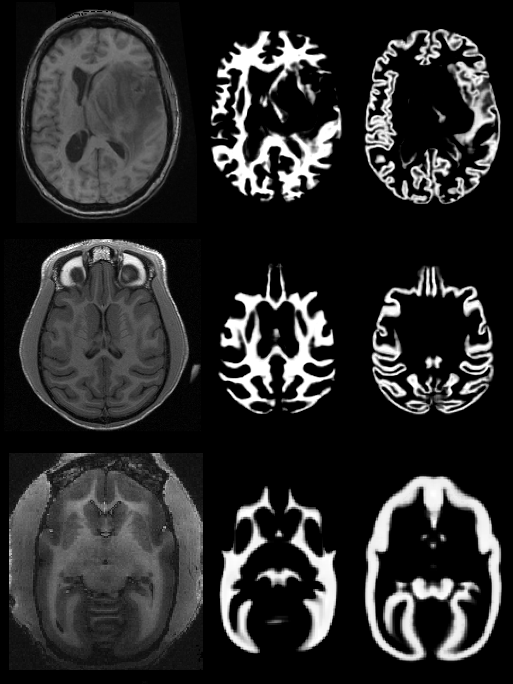

<section class="output" id="output-sec">
  

    <h2 id="output">Output</h2>
    
U-Net Studio can output 3D labels or 4D probabilistic maps for quantifying tissue characteristics. The tissue segmentation includes white matter, gray matter (excluding basal ganglion), basal ganglion, and others.

  

  <figure></figure>
</section>

<section class="about">
  

    <h2 id="about">About</h2>
    
The current version only provides skull-stripping and segmentation of white matter, gray matter, cerebellum cortex, and basal ganglia. More detailed segmentation is under planning.

  

  

    <small>arXiv · 2023</small>
    FC Yeh, "Brain MRI Segmentation using Template-Based Training and Visual Perception Augmentation", arXiv:2308.02363.
    <a href="https://arxiv.org/abs/2308.02363">arxiv.org/abs/2308.02363</a> · <a href="/download.html#citation">How to cite</a>
    Free for academic or research purposes under <a href="https://creativecommons.org/licenses/by-nc-sa/4.0/legalcode">CC BY-NC-SA 4.0</a>.
  

</section>
